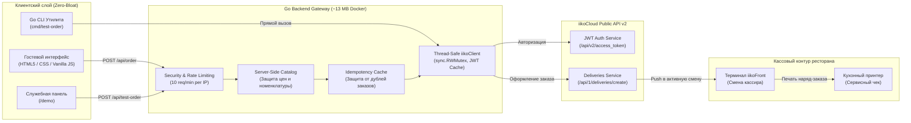

# BEINI — FoodTech веб-сервис & iikoCloud Integration Gateway

<p align="center">
  
</p>

<p align="center">
  <strong>Современный веб-сервис онлайн-заказа и бронирования для ресторана BEINI с прямой интеграцией в кассовую систему iikoFront через iikoCloud API v2.</strong>
</p>

<p align="center">
  
  
  
  
  
  
  
</p>

---

## 📌 О проекте

**BEINI** — ресторан кавказской, европейской и авторской кухни в Назрани (ул. С. С. Осканова, 21).

Данный проект — это высокопроизводительный, надежный FoodTech-шлюз и веб-интерфейс, объединяющий гостевой опыт (онлайн-меню, умная корзина, бронирование столиков и закрытых кабинок) с автоматической сквозной передачей заказов на кассовый терминал **iikoFront** без участия оператора-посредника.

> [!IMPORTANT]
> **Статус боевого внедрения:**  
> Интеграция успешно прошла живое тестирование непосредственно в ресторане на кассовом терминале **iikoFront** (терминал Амины, версия iikoFront `9.4.9102.0`). Подтвержден полный цикл: оформление на сайте $\rightarrow$ генерация чека в iikoCloud $\rightarrow$ звуковой сигнал на кассе $\rightarrow$ печать сервисного чека на кухне.

---

## 🏗 Архитектура системы



---

## ⚡ Ключевые возможности

* **Интерактивная ресторанная витрина:** фильтрация по категориям (мясо на углях, кавказская выпечка, супы, салаты, суши, пицца, авторские напитки и кофе с урбечом).
* **Моментальная корзина и чекаут:** выбор типа получения (доставка курьером или самовывоз), расчет стоимости и расчет времени подачи.
* **Сквозная фискализация iiko:** прямая передача данных заказа в кассу (состав, модификаторы, адрес, контакты гостя, тип оплаты).
* **Резервирование залов:** бронирование столиков в общем зале и приватных закрытых кабинок (до 10 гостей).
* **WhatsApp Fallback:** поддержка отправки дублирующего наряд-заказа в мессенджер управляющего при нестабильном интернет-канале.
* **Изолированный сервисный контур:** страница `/demo` для мониторинга кассовой смены и консольная утилита `cmd/test-order` для инженеров поддержки.

---

## 🛠 Инженерные решения и надежность

### 1. Бэкенд на Golang (FoodTech Gateway)
* **Потокобезопасная авторизация в iikoCloud:** клиент реализует протокол iiko API v2 с безопасным кэшированием JWT-токена и обновлением по истечении TTL с использованием двойной проверки (`sync.RWMutex`).
* **Серверная верификация цен (`internal/catalog`):** клиент не может подделать стоимость позиций; бэкенд сопоставляет каждый `iikoId` с эталонным каталогом заведения перед отправкой в кассу.
* **Идемпотентность заказов (`internal/idempotency`):** защита от случайных дабл-кликов и повторных отправок с помощью заголовка `X-Idempotency-Key` или хэширования тела заказа с TTL-очисткой.
* **Rate Limiting (`internal/middleware`):** защита эндпоинта оформления заказов (скользящее окно на 10 заказов в минуту с одного IP).
* **Защищенный FileServer:** строгая блокировка доступа к системным файлам (`.env`, `.git`, `.go`, `.json`, `.exe`) и корректная маршрутизация с честными HTTP 404 для статических ресурсов и SPA-fallback для страниц.
* **Production-Ready:** структурированное логирование `log/slog`, корректная обработка паник (Recoverer), контекстные таймауты (Read 15s, Write 45s, Idle 60s) и Graceful Shutdown (SIGINT/SIGTERM, 10s).

### 2. Фронтенд-философия: Subtractive Design (Zero-Bloat)
* **0 KB runtime-зависимостей:** проект не использует внешние фреймворки, React/Vue, Tailwind CDN или иконочные шрифты.
* **Чистый стек:** нативный HTML5, CSS Variables, CSS Grid / Flexbox и Vanilla JavaScript.
* **Mobile-First UX:** все интерактивные тап-зоны адаптированы под палец (строго `min-height: 44px`, `touch-action: manipulation`), плавная шторка заказа (Bottom Sheet) с поддержкой динамической высоты `dvh`.
* **Аутентичная типографика:** элегантный акцидентный шрифт `Cormorant` с включенными непрыгающими цифрами цен (`font-variant-numeric: lining-nums`) в паре со сверхчитаемым кириллическим гротеском `Golos Text`.

---

## 📡 HTTP API Спецификация

| Метод | Эндпоинт | Доступ | Назначение |
| :--- | :--- | :--- | :--- |
| `GET` | `/` | Публичный | Главная страница и витрина ресторана |
| `GET` | `/api/health` | Публичный | Проверка работоспособности сервиса (healthcheck) |
| `POST` | `/api/order` | Rate Limited (10/min) | Прием заказа от гостя и регистрация доставки в iikoCloud |
| `POST` | `/api/test-order` | `X-Test-Token` / Localhost | Тестовая отправка на терминал кассира |
| `GET` | `/demo` | Изолированный | Панель диагностики связи с кассой iikoFront |

---

## 🚀 Быстрый старт и запуск

### Требования
* **Go** 1.22+ (рекомендуется 1.24+)
* **Docker & Docker Compose** (опционально для контейнеризации)

### 1. Клонирование репозитория
```bash
git clone https://github.com/your-username/beini.git
cd beini
```

### 2. Конфигурация
Скопируйте пример файла настроек и укажите свои параметры iikoCloud:
```bash
cp iiko_config.example.json iiko_config.json
```
Параметры также могут быть переопределены через переменные окружения: `PORT`, `IIKO_API_KEY`, `IIKO_APP_ID`, `IIKO_CLIENT_SECRET`, `IIKO_ORGANIZATION_ID`, `IIKO_TERMINAL_GROUP_ID`.

### 3. Запуск модульных тестов
Тесты изолированы от внешних сетевых вызовов и выполняются на мок-серверах (`httptest.Server`):
```bash
go test -v ./...
```

### 4. Локальный запуск
```bash
go run ./cmd/server
```
Сервер будет доступен по адресу: `http://localhost:8080`.

### 5. Экспресс-тест кассы через CLI
Для мгновенной проверки связи с кассовым терминалом без запуска браузера:
```bash
go run ./cmd/test-order
```

---

## 🐳 Развертывание в Docker

В проекте используется двухэтапная сборка (Multi-stage build) на базе минимального образа `alpine:3.19`. Итоговый вес контейнера составляет всего **~13.2 МБ**.

### Запуск через Docker Compose:
```bash
docker compose up -d --build
```

### Ручная сборка и запуск контейнера:
```bash
# Сборка образа
docker build -t beini-backend .

# Запуск с монтированием конфигурационного файла
docker run -d \
  --name beini-app \
  -p 8080:8080 \
  -v "$(pwd)/iiko_config.json:/app/iiko_config.json:ro" \
  beini-backend
```

---

## 📂 Структура проекта

```text
beini/
├── assets/                     # Статические медиа-ресурсы (логотипы, фото блюд, интерьеры)
│   └── images/
│       ├── brand/              # Фирменная символика и герб BEINI
│       └── dishes/             # Каталог блюд высокого разрешения
├── cmd/
│   ├── server/                 # Главная точка входа HTTP-сервера (роутинг, graceful shutdown)
│   └── test-order/             # Консольная утилита экспресс-тестирования связи с кассой
├── css/
│   └── style.css               # Дизайн-система (CSS Custom Properties, сетка, анимации)
├── data/                       # Локальные схемы и снапшоты номенклатуры
├── internal/
│   ├── catalog/                # Каталог позиций и валидатор эталонных цен
│   ├── config/                 # Парсер конфигурации (JSON + Environment fallback)
│   ├── domain/                 # Доменные структуры заказа, валидаторы
│   ├── handler/                # HTTP-контроллеры (/api/order, /api/health, /api/test-order)
│   ├── idempotency/            # Потокобезопасное in-memory хранилище идемпотентности
│   ├── iiko/                   # Клиент iikoCloud API v2 (JWT, DTO, Deliveries)
│   └── middleware/             # Middleware: CORS, slog-логгер, Recoverer, Rate Limiting
├── js/
│   ├── app.js                  # Фронтенд-контроллер (корзина, бронь, отправка API)
│   └── menu-data.js            # Локальный каталог витрины с сопоставлением UUID iiko
├── tools/
│   ├── import_menu.py          # Утилита выгрузки и синхронизации номенклатуры iikoWeb
│   └── test_order.py           # Автономный скрипт диагностики iikoCloud API
├── demo.html                   # Изолированная сервисная панель для кассиров и инженеров
├── Dockerfile                  # Легковесный Multi-stage образ (~13 МБ)
├── docker-compose.yml          # Манифест оркестрации
├── go.mod                      # Определение модуля Go
└── index.html                  # Главная страница ресторана и интерактивное меню
```

---

## ⚖️ Лицензия

Распространяется под лицензией [MIT](LICENSE).
